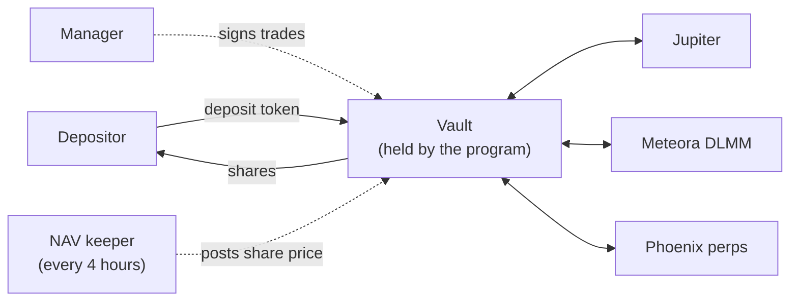

  

<h1 align="center">Hedgin</h1>

  Investment vaults on Solana where a program, not a person, holds the money.

  <a href="https://hedgin.xyz/vaults">App</a> ·
  <a href="https://docs.hedgin.xyz">Docs</a> ·
  <a href="https://www.npmjs.com/package/@hedginxyz/sdk">SDK</a> ·
  <a href="https://x.com/hedginxyz">X</a>

---

You deposit one token, such as USDC, into a vault and get shares back. A manager trades the vault to grow it. Every 4 hours we value the vault and publish a share price, and deposits and withdrawals settle at that price.

The manager can trade, but the manager can't take your money. A Solana program holds every vault's tokens and moves them to only four places: Jupiter for swaps, Meteora DLMM for liquidity, Phoenix for perpetuals, and the depositor's own wallet. There is no instruction that sends vault tokens to the manager. The program is live on Solana mainnet as `r2ahBQ6gbPCJ9FxBymYcXuwXi8NmenRry7SE7QR7FAt`.

## What we build

Most of our code is private because it runs a live protocol that holds user funds. The parts that partners build on are public.

| Part | What it does | Code |
| --- | --- | --- |
| Hedge Vault program | An Anchor program on Solana. It holds custody and enforces shares, fees, roles, and every trade. | Private |
| Web app | Where depositors join vaults and managers run them. The server builds each transaction, your wallet signs it. | Private |
| NAV keeper | Values every position in a vault every 4 hours and posts the price on chain. It posts a full valuation or nothing. | Private |
| Manager API | Lets a bot build vault trades over HTTP. An API key can request a transaction but can't sign one. | Private |
| [`@hedginxyz/sdk`](https://github.com/HedginVault/sdk) | TypeScript client for the Manager API. It refuses to sign any transaction that could move funds out of the manager's wallet. | Public |
| [Telegram bot](https://github.com/HedginVault/telegram-bot) | A reference bot that runs a vault from Telegram through the SDK. | Public |
| [Docs](https://github.com/HedginVault/docs) | The source for [docs.hedgin.xyz](https://docs.hedgin.xyz) and the OpenAPI spec. | Public |

## How we keep funds safe

- The program is the only authority. It checks every signer, account, and cross-program call. The app and the bots check the same rules early, but only so you see an error before you sign.
- The keeper never posts a partial or guessed price. If one position can't be priced, it skips the post and tries again, so requests wait instead of settling at a wrong price.
- The program caps how far the share price can move in one post. A bigger move is rejected and reviewed by an administrator.
- Your browser never sends a transaction. Our server builds and simulates it, your wallet signs it, and the server relays it.
- Our database keeps history and API keys. The chain is the ledger.

## Start here

- To deposit, open [hedgin.xyz/vaults](https://hedgin.xyz/vaults).
- To run a vault, read the [manager guide](https://docs.hedgin.xyz/managers/overview).
- To automate a vault, install the SDK with `yarn add @hedginxyz/sdk @solana/web3.js` and read the [API reference](https://docs.hedgin.xyz/api-reference/introduction).
